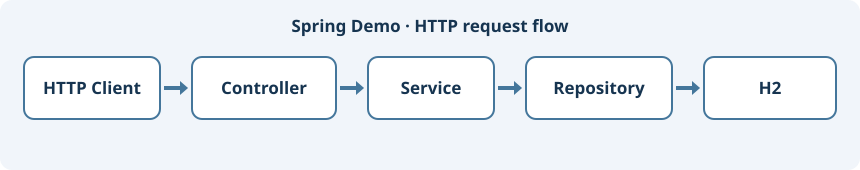
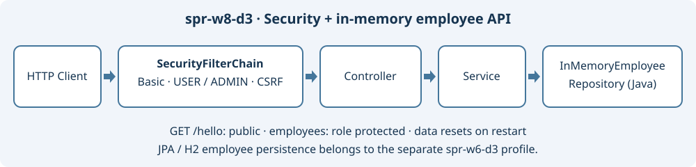

# Spring Demo | 社員・部署管理 API

Spring Bootで社員・部署管理のREST APIを作る学習プロジェクトです。Controller・Service・Repositoryの分離、入力検証、トランザクション、認証・認可をプロファイルごとに確認できます。

## 入手方法

公開リポジトリをcloneし、プロジェクトのルートへ移動してから、下記のビルド・起動手順を実行してください。

```powershell
git clone https://github.com/YuzuTomato4423/spring-demo.git
cd spring-demo
```


## 実行前の確認

<!-- SPR-W9-D1-03: 第三者の実行環境を確認できるよう、Wrapperが実際に使うJavaとPowerShellの確認手順を追加する。 -->

Windowsの実行例はJDK 17とPowerShell 7を使用します。clone先のルートで確認してください。

```powershell
java -version
$PSVersionTable.PSVersion
.\mvnw.cmd --version
```

`java` とMavenの表示がどちらもJava 17であることを確認します。異なる場合は、このPowerShellの `JAVA_HOME` と `PATH` を用意したJDK 17へ合わせてから実行してください。初回はWrapper本体と依存ライブラリの取得にネットワーク接続が必要です。まず後述の「ビルドと今回のテスト実績」のコマンドでビルド・テストを行い、その後に使用するモードを1つ選んで起動します。停止は起動したPowerShellで `Ctrl+C` です。

## 技術と実行モード

| 技術 | 用途 |
| --- | --- |
| Java 17 / Spring Boot 4.1.1 | APIの実行基盤 |
| Spring Web MVC / Bean Validation | HTTP受付・入力検証・DTO応答 |
| Spring Data JPA / H2 | JPA演習の永続化 |
| Spring Security | HTTP Basic・ロール認可・CSRF保護 |
| JUnit / Spring Boot Test / MockMvc | API・サービス・DB・Securityの確認 |
| Maven Wrapper | ビルド・テスト |

| プロファイル | 社員APIの保存先 | 主な確認内容 |
| --- | --- | --- |
| `spr-w6-d3` | JPA → H2メモリDB | 社員CRUD、検索、一括異動、トランザクション |
| `spr-w8-d3` | `InMemoryEmployeeRepository` | HTTP Basic、USER／ADMIN、401／403、CSRF |

2つのモードは**別々に起動**します。Securityモードは既存のメモリ社員APIを使い、社員データは再起動で失われます。JPAモードと入力DTO・保存経路が異なります。Security設定でH2メモリDBも初期化されますが、社員APIの保存先はJavaのメモリRepositoryです。

## Securityの概要と保護対象

<!-- SPR-W8-D4-01: 公開説明用として、認証・認可・保護対象と学習環境の前提を記録する。 -->

**認証**は「誰がアクセスしたか」の確認です。`spr-w8-d3` ではHTTP Basicで `training-user`／`training-admin` を確認します。パスワードは起動時の環境変数から受け取り、BCryptでハッシュ化してメモリに保持します。2つのパスワードは空でなく、互いに異なる必要があります。

**認可**は「認証した利用者に何を許可するか」の判断です。

| リクエスト | 未認証 | USER | ADMIN |
| --- | --- | --- | --- |
| `GET /hello` | 200 | 200 | 200 |
| `GET /employees`、`GET /employees/{id}` | 401 | 許可 | 許可 |
| `POST /employees` | 401※ | 403※ | 許可※ |
| `PUT /employees/{id}` | 401※ | 403※ | 許可※ |
| `DELETE /employees/{id}` | 401※ | 403※ | 許可※ |
| 上記以外 | 許可しない | 許可しない | 許可しない |

「許可」はSecurityの判定です。存在しない社員は404、入力不正は400など、API側の判定は別に行われます。※更新系は有効なCSRFトークンと同じセッションを渡した場合の認証・認可の結果です。MockMvcではADMINのCSRF不足が403になることを検証しています。実HTTPではCSRFがBasic認証より先に拒否するため、資格情報付きでも、セッション・トークンなしのPOSTは今回401となりました。CSRF不足の応答だけからロールの可否は判断できません。

401は資格情報がない／誤っている場合、403は認証後の権限不足、またはCSRF検証失敗です。フォームログインやCSRFトークン配布用APIは追加していません。更新系の成功・拒否は、実際のSecurityフィルターが発行したトークンを同じセッションで返す[Securityテスト](src/test/java/com/example/demo/Week8Day3SecurityTests.java)で再現できます。

HTTP Basicは資格情報を暗号化しないため、この演習は `127.0.0.1` の学習環境で実行します。H2 Consoleは無効です。`spr-w8-d2` は認証導入段階の別演習で、上記のロール表は `spr-w8-d3` に適用されます。これら以外の既存演習プロファイルでは、Security自動構成を除外して従来のHTTP動作を維持しています。

### Securityモードを起動・確認する

JDK 17とPowerShell 7を用意し、リポジトリのルートで実行します。初回は依存ライブラリを取得するネットワークが必要です。

```powershell
java -version
$user = Get-Credential -UserName 'training-user' -Message '学習用USERのパスワード'
$admin = Get-Credential -UserName 'training-admin' -Message '異なる学習用ADMINのパスワード'
$env:SPR_W8_D3_USER_PASSWORD = $user.GetNetworkCredential().Password
$env:SPR_W8_D3_ADMIN_PASSWORD = $admin.GetNetworkCredential().Password
try {
    .\mvnw.cmd spring-boot:run "-Dspring-boot.run.profiles=spr-w8-d3" "-Dspring-boot.run.arguments=--server.port=8080"
} finally {
    Remove-Item Env:SPR_W8_D3_USER_PASSWORD, Env:SPR_W8_D3_ADMIN_PASSWORD
}
```

別のPowerShell 7で同じUSERの資格情報を入力し、公開GET・未認証401・認証済み200を確認します。パスワードの値やAuthorizationヘッダーは記録・撮影しません。

```powershell
$base = 'http://127.0.0.1:8080'
(Invoke-WebRequest "$base/hello").Content
(Invoke-WebRequest "$base/employees" -SkipHttpErrorCheck).StatusCode
$user = Get-Credential -UserName 'training-user' -Message '起動時と同じUSERパスワード'
$response = Invoke-WebRequest "$base/employees" -Authentication Basic -Credential $user -AllowUnencryptedAuthentication
$response.StatusCode
$response.Content  # 起動直後は []
```

## JPAモードの代表API

<!-- SPR-W8-D4-02: 第三者が構成と動作を理解し再現できるよう、モード別の手順・実績・画像を整理する。 -->

Securityモードを停止してから起動します。このモードでは部署1（開発部）・部署2（営業部）が用意され、社員は空から始まります。

```powershell
.\mvnw.cmd spring-boot:run "-Dspring-boot.run.profiles=spr-w6-d3" "-Dspring-boot.run.arguments=--server.address=127.0.0.1 --server.port=8080"
```

別のPowerShell 7で実行します。

```powershell
$base = 'http://127.0.0.1:8080'
$employee = @{ name = 'Sample Employee'; email = 'sample.employee@example.test'; departmentId = 1 }
$created = Invoke-WebRequest "$base/employees" -Method Post -ContentType 'application/json' -Body ($employee | ConvertTo-Json)
$created.StatusCode
$created.Content
$id = ($created.Content | ConvertFrom-Json).id
$fetched = Invoke-WebRequest "$base/employees/$id"
$fetched.StatusCode
$fetched.Content
$employee.name = ''
$invalid = Invoke-WebRequest "$base/employees" -Method Post -ContentType 'application/json' -Body ($employee | ConvertTo-Json) -SkipHttpErrorCheck
$invalid.StatusCode
$invalid.Content
```

| 操作 | 期待する結果 |
| --- | --- |
| JPA: `POST /employees` | 201、Location、登録社員のJSON |
| JPA: `GET /employees/{id}` | 200、登録時と同じ社員のJSON |
| JPA: 空の名前で `POST /employees` | 400、`errors.name` |
| Security: 公開 `GET /hello` | 200、`Hello Spring!` |
| Security: 未認証 `GET /employees` | 401 |
| Security: USER／ADMINの `GET /employees` | 200、初期状態は `[]` |

JPAの登録・取得例：

```json
{"id":1,"name":"Sample Employee","email":"sample.employee@example.test","departmentName":"開発部"}
```

### 設定例ファイルを使って起動する

<!-- SPR-W9-D1-03: 設定例へのリンクだけでは適用手順が分からないため、ルート基準の実行コマンドを示す。 -->

JPAモードの上記起動コマンドの代わりに、同じ設定の[設定例](docs/application-example.properties)を読み込む方法も使えます。他のサーバーを停止し、clone先のルートで実行してください。

```powershell
.\mvnw.cmd spring-boot:run "-Dspring-boot.run.arguments=--spring.config.additional-location=file:./docs/application-example.properties"
```

`127.0.0.1:8080` で `spr-w6-d3` が起動し、上記と同じ登録・取得・入力検証の例を実行できます。この設定例はJPA専用です。Securityモードでは前述の環境変数と起動手順を使用します。

一覧・更新・削除・一括異動は[社員APIの課題メモ](docs/SPR-W6-D3-README.md)、DB分離は[統合テストの課題メモ](docs/SPR-W7-D2-README.md)、ポート設定は[設定例](docs/application-example.properties)を参照してください。

## 構成図

JPAモード：HTTP → Controller → Service → Repository → H2。



Securityモード：SecurityFilterChainで認証・認可・CSRFを確認し、メモリ社員APIへ進みます。



## ビルドと今回のテスト実績

```powershell
.\mvnw.cmd -B clean package
.\mvnw.cmd "-Dtest=Week8Day3SecurityTests" test
```

検証日時：**2026-11-13 10:01:58 JST**。Java 17、Maven Wrapperによる `clean package` は **BUILD SUCCESS**。全体 **173件、失敗0、エラー0、スキップ0**（Securityの7件を含む）。テスト用DB・起動ポートは各テストで分離しています。

Securityの7件は、公開GET、不正パスワード、両ロールの参照、同一更新の401／403／200、CSRF不足、管理者だけの登録・削除、未許可パスの拒否を確認します。

## 実行画像と今回の検証記録

既存のJPA代表API画像です。Week7で取得した学習用データの画面を保持しています。


今回のSecurity／JPAの実測は[API結果](docs/validation/w8d4-api-results.txt)、173件の成功は[テスト結果抜粋](docs/validation/w8d4-test-results.txt)を参照してください。[検証メモ](docs/SPR-W8-D4-validation.md)に証跡の取得状況を記載しています。Week8 Day4の追加スクリーンショットは未取得です。Day5の公開直前チェックと全テストの再実行結果は[公開確認記録](docs/SPR-W8-D5-publication.md)と[今回のテスト結果](docs/validation/w8d5-test-results.txt)を参照してください。

## 学習課題との対応

| 課題 | 成果 |
| --- | --- |
| SPR-W8-D4-01 | 公開説明用の認証・認可・保護対象・CSRF説明 |
| SPR-W8-D4-02 | 第三者が再現できるAPI・構成図・テスト実績・画像 |
| SPR-W8-D4-03 | 不要／機密ファイルを点検した公開候補commit |

<!-- SPR-W8-D4-03: Public化直前の公開候補commit。公開設定の変更と最終Go/No-Goは次の課題で行う。 -->

既存の課題メモは `docs/` に保持しています。

## 公開前の最終確認

<!-- SPR-W8-D5-01: 現在ファイルと公開対象のGit履歴に秘密情報・個人情報・実データが混入していないかを最終確認する。 -->
<!-- SPR-W8-D5-02: README・画像・除外設定・全テストの確認結果を根拠にGo/No-Goを判断する。 -->

2026-11-13、公開候補の現在ファイル316件と全6コミット（内容が異なるblob 324件）を点検しました。既知形式の秘密値、個人端末パス、実データの混入は見つかりませんでした。資格情報の候補25件は環境変数参照・空の学習用H2設定・実行時生成値などと確認しました。社員名・メールアドレスは架空データで、メールには `example.test` を使っています。

Java 17で全173件のテストが成功し、失敗0・エラー0・スキップ0でした。READMEの参照先・公開用画像・設定例と `.gitignore` も点検し、公開前の判定は **Go** としました。[詳細と公開後の確認](docs/SPR-W8-D5-publication.md)を参照してください。

## 公開状態

<!-- SPR-W8-D5-03: 公開日時と、未ログインでREADME・画像・ファイル一覧を表示できることを記録する。 -->
<!-- SPR-W8-D5-04: 公開後の軽微修正として、clone手順と公開確認結果を追記する。 -->

2026-11-13 10:17:16 JSTにPublicへ切り替えました。未ログインでREADME・ファイル一覧・コード・画像を確認済みです。公開後にclone手順と今回の公開確認結果を追記しました。[公開確認記録](docs/SPR-W8-D5-publication.md)に判定根拠と確認内容をまとめています。

## 公開後の再現性確認

<!-- SPR-W9-D1-01: Publicから新規cloneし、第三者がREADMEだけでbuild/run/testできることを確認する。 -->
<!-- SPR-W9-D1-02: 公開後監査として、手順・画像リンク・設定例・不要/機密ファイルを再確認する。 -->

2026-11-16、公開リポジトリを別フォルダへ認証情報なしでcloneし、Java 17で全173件とSecurity専用7件が成功しました。JPAの201・200・400、Securityの200・401・認証済み200もREADMEのPowerShell例で確認しました。環境確認・停止方法と設定例の適用コマンドを追記しています。[確認内容と修正理由](docs/SPR-W9-D1-reproducibility.md)を参照してください。

## 公開後の品質改善

<!-- SPR-W9-D4-04: 変更した入力検証と旧データの互換性に加え、既存のAPI・永続化・認可への回帰がないことを確認する。 -->

- [#1 社員名の長さ検証](https://github.com/YuzuTomato4423/spring-demo/issues/1)。 `spr-w6-d3` 系の登録・更新では、氏名を必須かつ255文字以内とします。上限を超える入力には HTTP 400 と `errors.name` を返します。
- [#2 一括異動の回帰テスト](https://github.com/YuzuTomato4423/spring-demo/issues/2)。 メール未登録の旧社員と登録済みの社員をまとめて異動し、氏名とメール値を保持することを確認しました。
- [#3 永続 H2 の移行手順](https://github.com/YuzuTomato4423/spring-demo/issues/3)。 スキーマ移行と復元の手順整備は今後の課題です。

Java 17 の Maven Wrapper で全回帰テストを実行し、失敗・エラー・スキップが0件であることを確認しました。
