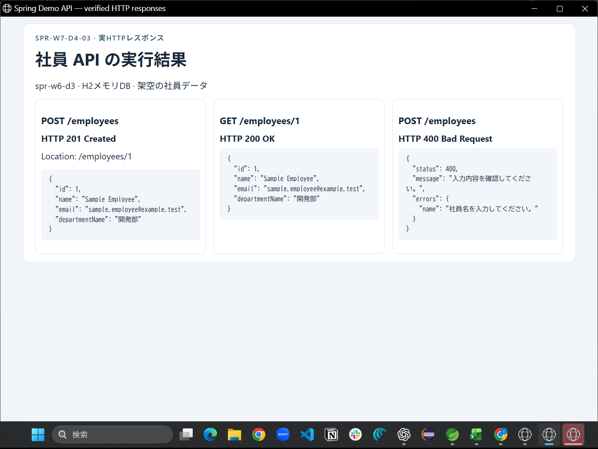

# Spring Demo | 社員・部署管理 API

Spring Bootで社員・部署管理のREST APIを作る学習プロジェクトです。社員の登録・取得・更新・削除、部署との関連、入力検証、複数社員の一括異動を実装しています。

## 学習目的と構成

HTTPリクエストを受けるController、業務ルールとトランザクションを扱うService、永続化を担うRepositoryの役割を分けます。入力エラーをHTTPレスポンスに変換し、実HTTPとDBの両方から動作を検証します。

| 技術 | 用途 |
| --- | --- |
| Java 17 / Spring Boot 4.1.1 | APIの実行基盤 |
| Spring Web MVC / Bean Validation | ルーティングと入力検証 |
| Spring Data JPA / H2 | 社員・部署の永続化と学習用DB |
| JUnit / Spring Boot Test / MockMvc | API・サービス・DBの動作確認 |
| Maven Wrapper | ビルドとテストの実行 |

## 起動する

**必要環境** はJDK 17とPowerShell 7です。コマンドはリポジトリのルートで実行します。初回はMavenと依存ライブラリを取得できるネットワークが必要です。

```powershell
java -version
.\mvnw.cmd spring-boot:run "-Dspring-boot.run.profiles=spr-w6-d3" "-Dspring-boot.run.arguments=--server.address=127.0.0.1 --server.port=8080"
```

Spring Tools for Eclipseでは、プロジェクトをMavenプロジェクトとして取り込み、`SPR-W6-D3.launch` からも起動できます。ここで使う `spr-w6-d3` は起動ごとに独立したH2メモリDBを使います。部署1（開発部）と部署2（営業部）が用意され、社員は空の状態で始まります。[設定例](docs/application-example.properties)でポートとProfileの指定を確認できます。

## 代表APIを試す

サーバーを起動したまま、別のPowerShell 7で次を実行します。登録時に返されたIDをそのまま取得リクエストに使います。

```powershell
$base = 'http://127.0.0.1:8080'
$employee = @{ name = 'Sample Employee'; email = 'sample.employee@example.test'; departmentId = 1 }
$created = Invoke-WebRequest "$base/employees" -Method Post -ContentType 'application/json' -Body ($employee | ConvertTo-Json)
$created.StatusCode
$created.Content
$id = ($created.Content | ConvertFrom-Json).id

$fetched = Invoke-WebRequest "$base/employees/$id"
$fetched.StatusCode
$fetched.Content

$employee.name = ''
$invalid = Invoke-WebRequest "$base/employees" -Method Post -ContentType 'application/json' -Body ($employee | ConvertTo-Json) -SkipHttpErrorCheck
$invalid.StatusCode
$invalid.Content
```

| 操作 | 確認する結果 |
| --- | --- |
| `POST /employees` | `201 Created` と社員のJSON。空のDBでの実測では `Location: /employees/1`。 |
| `GET /employees/{id}` | `200 OK` と登録時と同じ社員のJSON。 |
| 名前を空にして `POST /employees` | `400 Bad Request`。JSONの `errors.name` に入力エラー。 |

登録と取得で確認したJSONの例です。

```json
{"id":1,"name":"Sample Employee","email":"sample.employee@example.test","departmentName":"開発部"}
```

同じ例を最初から試す場合はサーバーを停止し、再起動してから実行します。一覧・更新・削除・一括異動の詳細は[社員APIの課題メモ](docs/SPR-W6-D3-README.md)を参照してください。

## ビルドとテスト

```powershell
.\mvnw.cmd test
.\mvnw.cmd "-Dtest=Week7Day2*Tests" test
.\mvnw.cmd package
```

全体テストでは入力検証、CRUD、トランザクションなどを確認します。Week7 Day2の統合テストは実HTTPからH2までを通し、テスト専用のH2メモリDBで実行します。Day4の検証では全体163件が成功しました。[統合テストの課題メモ](docs/SPR-W7-D2-README.md)にDB分離の詳細があります。

## 構成図と実行画面




SPR-W7-D4-03の公開用画像です。API実行画面は学習用の架空データを使った実測結果です。

## 学習課題との対応

| 課題 | 成果 |
| --- | --- |
| SPR-W7-D4-01 | 学習目的・システム概要・技術スタック |
| SPR-W7-D4-02 | 第三者が再現できる起動・API・テスト手順 |
| SPR-W7-D4-03 | 構成図と公開用のAPI実行画像 |
| SPR-W7-D4-04 | 公開判断前の確認と課題ID付き最終commit |
