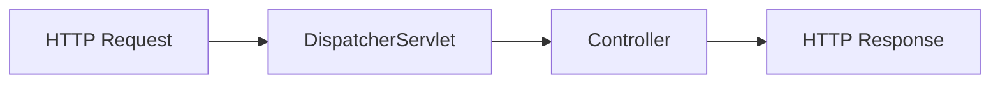

# SPR-W4-D1-01〜04：HTTP / Spring MVC基礎

## SPR-W4-D1-01：MVCフロー

HTTP Requestはメソッド・URL・queryを運ぶ。組み込みTomcatから受け取ったDispatcherServletは、HandlerMappingでURLとHTTPメソッドに対応するControllerを選び、HandlerAdapterを通して呼び出す。呼出し時にPathVariableやRequestParamがJava引数へ変換される。@RestControllerの戻り値はView名ではなく本文として扱われ、HttpMessageConverterがStringやJSONをHTTP Responseへ書き込む。

図の表示用ファイル：SPR-W4-D1-mvc-flow.html。

## SPR-W4-D1-02：Hello API

既存HelloControllerを利用。@RestControllerは戻り値をHTTP本文にするために使い、@GetMapping("/hello")でGETを受け付ける。Profile未指定では200と`Hello Spring!`。dev/prodの既存外部設定は維持する。

## SPR-W4-D1-03：PathVariable

`GET /employees/1`と`GET /employees/2`のJSON内idがそれぞれ1と2になる。`@PathVariable("id") int id`はパス内の値をJava引数に変換する。数値にできない`abc`は400。任意の整数を受け取る仮APIであり、社員の実在判定は行わない。

## SPR-W4-D1-04：RequestParam

`GET /employees?department=開発部`：departmentを返し、nameはnull。
`GET /employees?department=営業部`：部署条件の変更を確認。
`GET /employees?department=開発部&name=田中`：両条件を返す。

departmentは必須queryで、省略時400。nameは任意の追加条件で、省略時null。必須は「パラメータが存在する」ことを意味し、空文字の業務的検証は今回行わない。どちらも条件の受け渡しを学ぶ仮応答で、実データ検索はD2に残す。

## HTTPメソッドとステータス

GETは取得、POSTは登録、PUTは置換更新、DELETEは削除。今回実装するのはGETのみ。200は成功、400は入力不備、404は対象がない場合、405は非対応メソッド、500はサーバーエラー。登録時の201や実在社員の404は後続課題で扱う。

## 実行と証跡

EclipseでプロジェクトをRefreshし、SPR-W4-D1.launchをJava Applicationとして実行する。固定ポート8080は実行用設定にのみ指定する。既に使われている場合は既存プロセスを勝手に停止せず、実行設定を空きポートへ変更して記録する。

ブラウザのNetworkでRequest URL・Status・Responseを確認する。証跡はWindows標準Alt+Print Screenで対象ウィンドウを取得し、PNG保存後にカーソル・操作表示・色味・文字の読みやすさを確認する。Computer Useの観測画像は使用しない。

Microsoft EdgeのComputer Use操作は未承認のため、証跡はSPR-W4-D1-HTTP.launchを使うJava製RESTクライアントで取得する。Eclipseで起動した8080のアプリへ実際に6回GETし、URL・HTTPステータス・応答本文をConsoleへ表示する。ブラウザ開発者ツールの証跡は取得していない。
